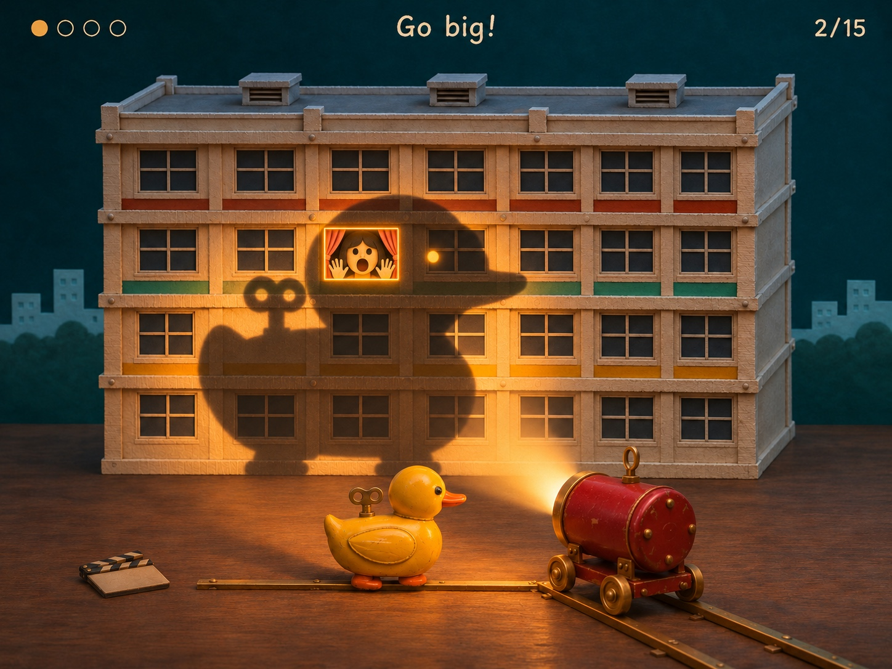
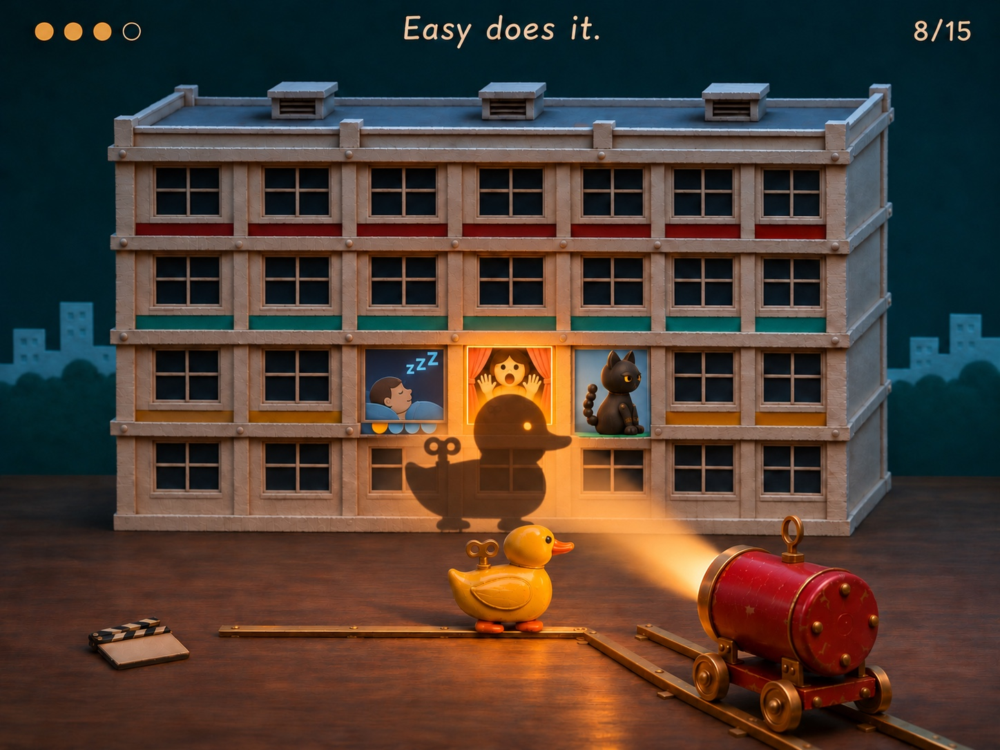
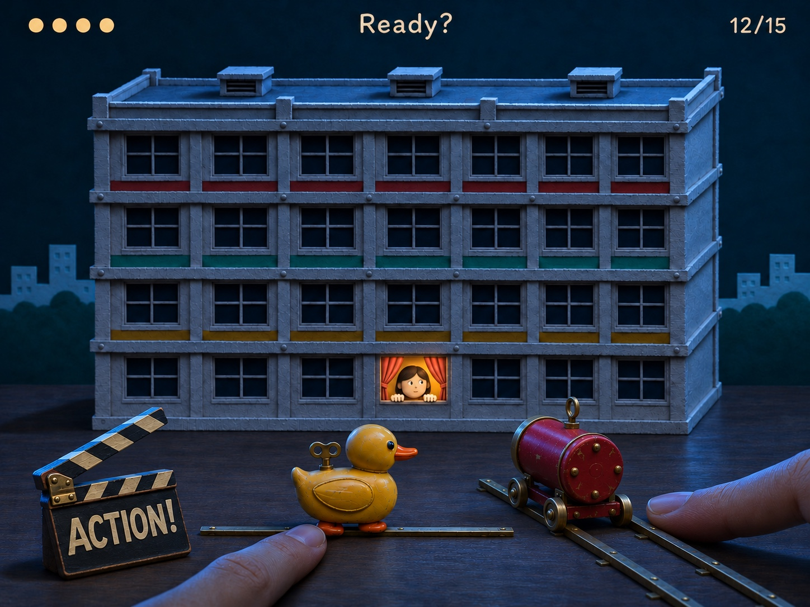

# 影子怪兽 · 双人夜场

三张 iPad 横屏 4:3 目标画面，对应双人原型的第一、第三和第四波。依次翻图时，盯住屋顶的三个通风口和一楼窗台：一名玩家沿纵深推灯，另一名沿横轨移鸭，建筑和镜头始终固定。

## 灯推近，影子够到三楼

用接近正面的轻俯视，只露一线屋顶和右翼。楼宽约占画面 79%，从画面高度的 11% 延伸到 71%。上沿留一行天空给波次圆点、短提示和分数，下方留给两只手。灯的红色后盖朝玩家，鸭嘴朝右。影子压过楼层色带，墙面纸纹和窗框仍看得见。影眼只是一点舞台效果，随投影移动。

## 灯拉远，让影子从两家邻居之间穿过

目标靠分开的珊瑚色窗帘、暖光和住户表情辨认。睡着的住户侧卧在蓝枕上，窗内有小小的 zZz。仔细看其窗台下的四瓣纸片。影子停留越久，纸片从左往右依次翻起，露出琥珀色的背面。影子移开后逐瓣放下。图中仅余一瓣。猫受到惊扰时在它的落脚处使用同一做法。猫身接近一扇窗高，黄眼和串珠尾巴在暗处仍可辨认。这一帧截在瞄准途中，得分时机沿用原型的覆盖率和停留时间。

## 熄灯，摆好再开拍

去掉工作灯的光斑、鸭影和影眼，保留目标窗的室内暖光。蓝色月光擦过灯轮、鸭背和轨边，两个人仍能摸准各自的玩具。左下的场记板张开，拍下 ACTION! 才揭晓投影。画中指尖示意真实双人触控，游戏里由玩家自己的手指占据这些位置。

**上机验收**　在 1024 × 768 横屏并排用两根手指按住灯和鸭，两指应能各自拖动，同时看清当前窗、受保护的住户和猫。把灯推近再拉远，核对同一只鸭影的大小、朝向和落点。熄灯后检查玩家能否找到两件玩具，同时只能预测影子的位置。
